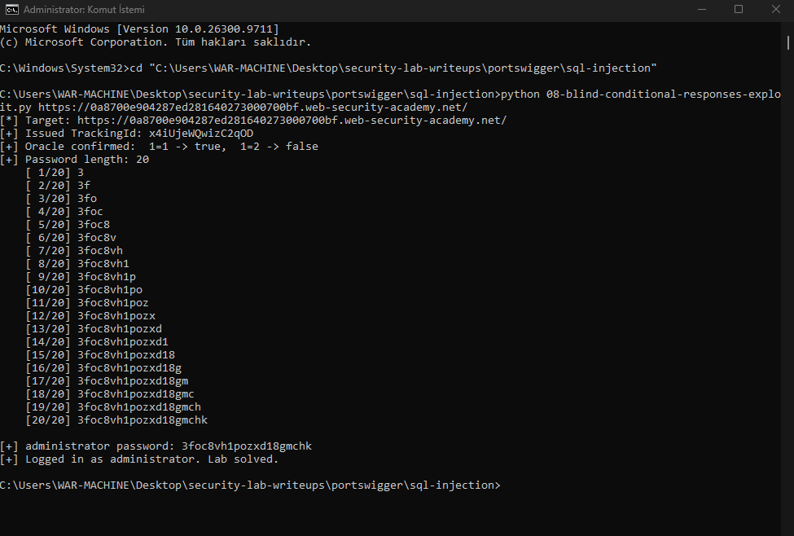

# Blind SQL Injection with Conditional Responses

- **Lab:** Blind SQL injection with conditional responses
- **Platform:** PortSwigger Web Security Academy
- **Category:** SQL Injection (OWASP A03:2021, Injection)
- **Difficulty:** Practitioner
- **Tool:** Burp Suite (Repeater), custom Python script
- **URL:** https://portswigger.net/web-security/sql-injection/blind/lab-conditional-responses

## Environment & Scope

Isolated training lab on PortSwigger's Web Security Academy. Each lab runs on a dedicated, disposable instance tied to my own account. No third-party or production systems were involved.

## Objective

The `TrackingId` cookie is placed into a server-side SQL query. The result is never printed, but the home page shows a "Welcome back" message when the query returns a row and omits it when the query returns nothing. That one visible difference is the only signal available. The goal is to use it to read the administrator's password one character at a time, then log in.

## Reconnaissance

The injection point is the `TrackingId` cookie, not a URL parameter. The application looks that value up on every request. There is no data on the page and no error output, but the presence or absence of "Welcome back" depends on whether the lookup returns a row. That makes it a boolean oracle: any yes/no question I can phrase in SQL, I can read off the page.

The cookie is also flagged `HttpOnly`, so it cannot be changed from the browser console. The attack has to come from a client that sets the `Cookie` header directly, which means Burp or a script, not JavaScript in the page.

## Exploitation

### Step 1: Confirm the boolean oracle

Working in Burp Repeater, I set the `TrackingId` cookie to a value with a condition appended:

```
TrackingId=<id>' AND '1'='1
```

The query becomes `... WHERE TrackingId = '<id>' AND '1'='1'`. The condition is true, the row is returned, and the response contains "Welcome back". Changing the condition to one that is false:

```
TrackingId=<id>' AND '1'='2
```

removes "Welcome back" from the response. True and false now produce two different pages. The oracle works.

### Step 2: Find the password length

Before reading characters I need to know how many there are. I ask the database whether the password is longer than a given number:

```
TrackingId=<id>' AND (SELECT LENGTH(password) FROM users WHERE username='administrator')>19
```

This returns "Welcome back" (true), while `>20` does not. The password is 20 characters long. A binary search over the range finds this in a handful of requests instead of counting up one at a time.

### Step 3: The naive extraction, and why it did not scale

To read each character, the usual move is to test it against every candidate: for position 1, is it `a`, is it `b`, is it `c`, and so on, then repeat for all 20 positions. With a lowercase and digit character set that is 20 x 36, up to 720 requests. This is the classic Burp Intruder cluster bomb attack, and I set it up that way first.

In Burp Suite Community the Intruder tool is deliberately rate limited. Across the ~720 requests the attack ran slower than the lab instance stayed alive, and the instance was recycled before it finished. Every request then returned a connection error. The approach was sound, but the tool could not complete it inside the instance lifetime.

### Step 4: Automated extraction with binary search

Rather than fight the throttle, I wrote a small exploit in Python (standard library only) that drives the same oracle at full speed, and I changed the algorithm so it needs far fewer requests.

Instead of testing a character against up to 36 candidates, I binary search its ASCII value. Each question halves the range:

```
TrackingId=<id>' AND ASCII(SUBSTRING((SELECT password FROM users WHERE username='administrator'),1,1))>77
```

If "Welcome back" is present the character's code is above 77, if not it is 77 or below. About 7 questions pin down one character, so 20 characters cost roughly 150 requests instead of 720, and with no throttle the whole run takes a few seconds. The script fetches its own `TrackingId`, confirms the oracle, recovers the length, extracts every character, and finally logs in as administrator to confirm the result. The full script is in this repository: [08-blind-conditional-responses-exploit.py](08-blind-conditional-responses-exploit.py).

### Step 5: Result

The extracted administrator password was:

```
3foc8vh1pozxd18gmchk
```

Logging in as `administrator` with that password solved the lab.



## Impact

Nothing is ever printed, yet the entire password is recovered through a single one-bit signal: whether one phrase appears on the page. A boolean oracle is enough to read any value in the database character by character. Blind SQL injection is as dangerous as the visible kind, it only costs more requests. On a real target it reaches credentials, session data, or anything else the application's database account can see.

## Remediation

- **Parameterised queries (prepared statements)** for every value placed into a query, including values from cookies and headers, not only form fields and URL parameters. Bound input cannot change the query's logic.
- Do not put raw request data into SQL. The cookie here was trusted straight into a query.
- **Least privilege** for the application's database account, so an injection that does occur reaches as little as possible.
- A uniform response is not a complete fix. Removing the "Welcome back" difference would slow an attacker down, but the time-based variant of this attack still works, so the root cause has to be fixed, not the symptom.

## Key takeaway

A one-bit difference in a response, a message that appears or not, is a complete data exfiltration channel once it depends on attacker input. Two things made this practical. Phrasing each question in SQL as a true/false test turns an invisible query into a readable answer. And choosing the right method matters: when a generic tool hit a wall, a short custom script with a better algorithm, binary search instead of brute force, turned an impractical 720-request attack into ~150 requests that finished in seconds. Writing the exploit is often faster and more reliable than clicking through one.
